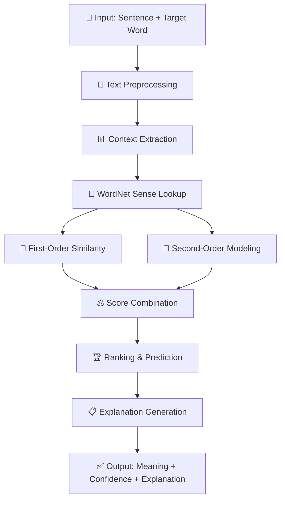
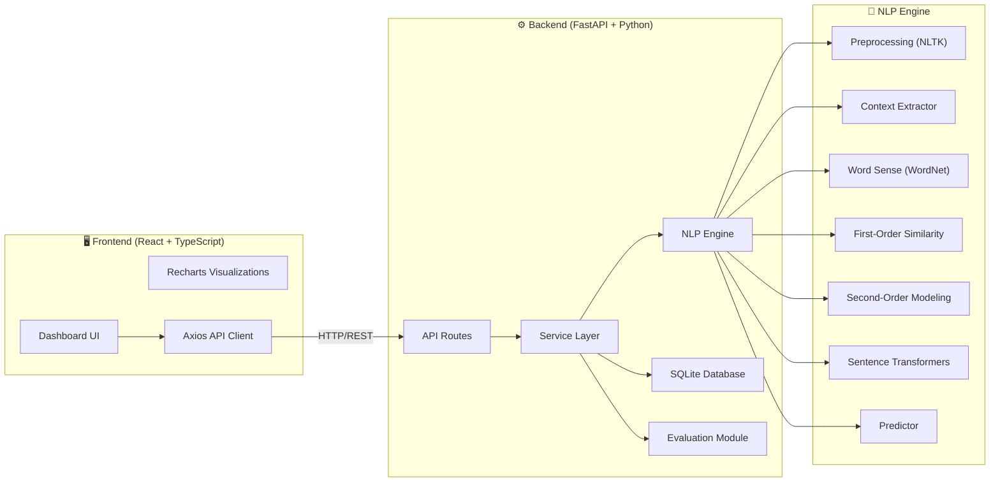

# 🧠 SemanticWSD — Second-Order Semantic Modeling for Context-Aware Meaning Prediction in Natural Language

[](https://python.org)
[](https://fastapi.tiangolo.com)
[](https://react.dev)
[](https://typescriptlang.org)
[](LICENSE)

An intelligent Natural Language Processing system that identifies the correct meaning of **ambiguous words** based on their surrounding sentence context using **first-order and second-order semantic modeling**.

---

## 📋 Table of Contents

- [Project Overview](#project-overview)
- [Problem Statement](#problem-statement)
- [Objectives](#objectives)
- [Proposed Methodology](#proposed-methodology)
- [System Architecture](#system-architecture)
- [Technologies Used](#technologies-used)
- [Installation](#installation)
- [Usage](#usage)
- [API Documentation](#api-documentation)
- [Sample Inputs & Outputs](#sample-inputs--outputs)
- [Evaluation Methodology](#evaluation-methodology)
- [Limitations](#limitations)
- [Future Enhancements](#future-enhancements)

---

## 🎯 Project Overview

**Word Sense Disambiguation (WSD)** is one of the fundamental challenges in Natural Language Processing. Many words in English are **polysemous** — they carry multiple meanings depending on context. This project implements a sophisticated WSD system that combines:

1. **First-Order Semantic Similarity** — Direct comparison between sentence context and candidate word meanings using sentence transformer embeddings.
2. **Second-Order Semantic Modeling** — Analysis of the *semantic neighborhoods* of context words and candidate senses, capturing deeper relational patterns.

The system provides transparent predictions with detailed explanations, confidence scores, and interactive visualizations.

---

## 🔍 Problem Statement

Natural language is inherently ambiguous. Consider the word **"bank"**:

| Sentence | Meaning |
|---|---|
| *"The bank approved my loan."* | Financial institution |
| *"We sat near the river bank."* | Land alongside a river |
| *"The plane performed a steep bank."* | Tilting of an aircraft |

Determining the correct meaning requires understanding the **surrounding context** — not just the target word in isolation. Traditional keyword-matching approaches fail to capture the nuanced semantic relationships that humans use intuitively.

---

## 🎯 Objectives

1. Develop a context-aware WSD system using semantic embeddings
2. Implement second-order semantic modeling to capture deeper contextual relationships
3. Provide transparent, explainable predictions with confidence scores
4. Build a professional web interface for interactive analysis
5. Evaluate the system against a curated disambiguation dataset
6. Create modular, maintainable code suitable for academic and research purposes

---

## 📐 Proposed Methodology

### Processing Pipeline



### First-Order Semantic Similarity

For each candidate sense $s_i$ of the target word:

$$\text{score}_{\text{first}}(s_i) = \cos(\mathbf{v}_{\text{context}}, \mathbf{v}_{s_i})$$

Where:
- $\mathbf{v}_{\text{context}}$ is the sentence embedding from a pre-trained transformer
- $\mathbf{v}_{s_i}$ is the embedding of the sense definition + examples + related words

### Second-Order Semantic Modeling

For each candidate sense $s_i$, we compute the semantic neighborhood similarity:

$$\text{score}_{\text{second}}(s_i) = \frac{1}{|C|} \sum_{c \in C} \max_{r \in R(s_i)} \cos(\mathbf{v}_c, \mathbf{v}_r)$$

Where:
- $C$ = set of context words
- $R(s_i)$ = semantic neighbors of sense $s_i$ (hypernyms, hyponyms, meronyms, holonyms)
- This captures whether the **relationships** of the candidate sense align with the **relationships** of context words

### Combined Score

$$\text{score}_{\text{combined}}(s_i) = w_1 \cdot \text{score}_{\text{first}}(s_i) + w_2 \cdot \text{score}_{\text{second}}(s_i)$$

Default weights: $w_1 = 0.6$, $w_2 = 0.4$

---

## 🏗️ System Architecture

### High-Level Architecture



### Directory Structure

```
semantic-wsd/
├── backend/
│   ├── app/
│   │   ├── main.py                 # FastAPI application entry
│   │   ├── api/
│   │   │   └── routes.py           # REST API endpoints
│   │   ├── core/
│   │   │   └── config.py           # Application settings
│   │   ├── models/
│   │   │   └── schemas.py          # Pydantic data models
│   │   ├── services/
│   │   │   └── prediction_service.py
│   │   ├── nlp/
│   │   │   ├── preprocessing.py    # NLTK text processing
│   │   │   ├── context_extractor.py
│   │   │   ├── word_sense.py       # WordNet integration
│   │   │   ├── similarity.py       # Sentence Transformers
│   │   │   ├── first_order.py      # First-order scoring
│   │   │   ├── second_order.py     # Second-order modeling
│   │   │   └── predictor.py        # Main prediction engine
│   │   ├── database/
│   │   │   └── db.py               # SQLite operations
│   │   └── evaluation/
│   │       └── evaluator.py        # WSD evaluation
│   ├── tests/
│   │   ├── test_preprocessing.py
│   │   ├── test_similarity.py
│   │   └── test_prediction.py
│   └── requirements.txt
├── frontend/
│   ├── src/
│   │   ├── App.tsx
│   │   ├── components/
│   │   │   └── Layout.tsx
│   │   ├── pages/
│   │   │   ├── Overview.tsx
│   │   │   ├── MeaningPredictor.tsx
│   │   │   ├── SemanticAnalysis.tsx
│   │   │   ├── ContextVisualization.tsx
│   │   │   ├── PredictionHistory.tsx
│   │   │   ├── ModelEvaluation.tsx
│   │   │   └── About.tsx
│   │   ├── charts/
│   │   ├── services/
│   │   ├── hooks/
│   │   └── types/
│   ├── index.html
│   ├── vite.config.ts
│   └── package.json
├── README.md
├── .gitignore
└── .env.example
```

---

## 🛠️ Technologies Used

### Backend
| Technology | Purpose |
|---|---|
| **Python 3.12** | Core programming language |
| **FastAPI** | High-performance REST API framework |
| **NLTK** | Tokenization, POS tagging, lemmatization, WordNet |
| **Sentence Transformers** | Contextual sentence embeddings (all-MiniLM-L6-v2) |
| **Scikit-learn** | Cosine similarity, evaluation metrics |
| **NumPy** | Numerical computations |
| **Pydantic** | Data validation and serialization |
| **SQLite + aiosqlite** | Async database for prediction history |

### Frontend
| Technology | Purpose |
|---|---|
| **React 18** | UI framework |
| **TypeScript** | Type-safe JavaScript |
| **Vite** | Build tool and dev server |
| **Tailwind CSS v4** | Utility-first styling |
| **Recharts** | Interactive data visualizations |
| **Lucide React** | Professional icon library |
| **React Router** | Client-side routing |
| **Axios** | HTTP client |

---

## 🚀 Installation

### Prerequisites

- Python 3.10+ 
- Node.js 18+
- npm 9+

### Backend Setup

```bash
# Navigate to backend directory
cd semantic-wsd/backend

# Create virtual environment
python -m venv venv

# Activate virtual environment
# Windows:
venv\Scripts\activate
# macOS/Linux:
source venv/bin/activate

# Install dependencies
pip install -r requirements.txt

# NLTK data will be downloaded automatically on first run

# Start the backend server
uvicorn app.main:app --reload --host 0.0.0.0 --port 8000
```

The first run will download the sentence-transformers model (~90MB) and NLTK data packages. This may take a few minutes.

### Frontend Setup

```bash
# Navigate to frontend directory
cd semantic-wsd/frontend

# Install dependencies
npm install

# Start the development server
npm run dev
```

### Access the Application

- **Frontend**: http://localhost:5173
- **Backend API**: http://localhost:8000
- **API Documentation (Swagger)**: http://localhost:8000/docs

---

## 💡 Usage

### Web Interface

1. **Overview Dashboard** — See project introduction, stats, and recent predictions
2. **Meaning Predictor** — Enter a sentence and target word to get disambiguated meaning
3. **Semantic Analysis** — View detailed score breakdowns and candidate comparisons
4. **Context Visualization** — Explore interactive word relationship graphs
5. **Prediction History** — Browse and revisit past predictions
6. **Model Evaluation** — Run evaluation against the curated WSD dataset

### Quick Start Example

1. Navigate to **Meaning Predictor**
2. Enter: *"The bank approved my loan application yesterday"*
3. Enter target word: *"bank"*
4. Click **Analyze Meaning**
5. View the predicted meaning, confidence score, and explanation

---

## 📡 API Documentation

### Endpoints

| Method | Endpoint | Description |
|---|---|---|
| `POST` | `/api/predict` | Predict meaning of ambiguous word |
| `POST` | `/api/analyze` | Full semantic analysis |
| `GET` | `/api/history` | List all prediction history |
| `GET` | `/api/history/{id}` | Get specific prediction details |
| `DELETE` | `/api/history` | Clear all prediction history |
| `GET` | `/api/evaluation` | Run model evaluation |
| `GET` | `/api/health` | Health check |

### Request Example

```bash
curl -X POST http://localhost:8000/api/predict \
  -H "Content-Type: application/json" \
  -d '{"sentence": "The bank approved my loan.", "target_word": "bank"}'
```

### Response Example

```json
{
  "sentence": "The bank approved my loan.",
  "target_word": "bank",
  "predicted_meaning": "a financial institution that accepts deposits and channels the money into lending activities",
  "confidence": 0.847,
  "similarity_score": 0.823,
  "first_order_score": 0.856,
  "second_order_score": 0.779,
  "alternative_meanings": [
    {
      "definition": "sloping land beside a body of water",
      "pos": "noun",
      "synset_name": "bank.n.01",
      "first_order_score": 0.412,
      "second_order_score": 0.389,
      "combined_score": 0.403
    }
  ],
  "explanation": "The word 'bank' is predicted to mean 'a financial institution...' because context words like 'approved', 'loan' are semantically related to financial and banking concepts...",
  "context_words": ["approved", "loan"],
  "processing_time": 0.342
}
```

---

## 📊 Sample Inputs & Outputs

| Input Sentence | Target Word | Predicted Meaning | Confidence |
|---|---|---|---|
| *"The bank approved my loan."* | bank | Financial institution | ~0.85 |
| *"We sat near the river bank."* | bank | Land alongside water | ~0.82 |
| *"He hit the ball with a cricket bat."* | bat | Sports equipment | ~0.80 |
| *"The bat flew out of the cave."* | bat | Nocturnal flying mammal | ~0.83 |
| *"She played a note on the bass."* | bass | Musical instrument | ~0.78 |
| *"Spring is my favorite season."* | spring | Season of the year | ~0.81 |
| *"The spring in the mattress broke."* | spring | Elastic device | ~0.76 |

> **Note**: Confidence scores are **similarity-based scores**, not calibrated probabilities. They indicate relative ranking strength among candidate senses.

---

## 📈 Evaluation Methodology

### Dataset

The system is evaluated against a **hand-curated WSD dataset** containing 30+ sentences covering 25+ ambiguous words. Each example has a ground-truth WordNet synset label.

### Metrics

| Metric | Description |
|---|---|
| **Accuracy** | Proportion of correctly predicted senses |
| **Precision** | Weighted precision across sense classes |
| **Recall** | Weighted recall across sense classes |
| **F1-Score** | Harmonic mean of precision and recall |

### Evaluation Process

1. For each test sentence, the system predicts the most likely WordNet synset
2. The predicted synset is compared against the ground-truth label
3. Metrics are computed using scikit-learn's classification report
4. Per-word accuracy breakdowns are provided
5. A confusion matrix visualizes prediction patterns

> **Important**: All evaluation metrics are computed from **real predictions** on the evaluation dataset. No results are fabricated or hardcoded.

---

## ⚠️ Limitations

1. **Vocabulary Coverage**: Limited to words present in WordNet's lexical database
2. **Context Window**: Performance may degrade with very short sentences (< 3 words)
3. **Domain Specificity**: The sentence-transformers model is trained on general English; domain-specific jargon may not be well-represented
4. **Computational Cost**: First run requires downloading the transformer model (~90MB)
5. **Sense Granularity**: WordNet's fine-grained senses can be difficult to distinguish even for humans
6. **Static Embeddings**: The system uses fixed pre-trained embeddings without task-specific fine-tuning
7. **Evaluation Scale**: The evaluation dataset is curated but relatively small; larger benchmark datasets (SemCor, SensEval) would provide more robust evaluation

---

## 🔮 Future Enhancements

1. **Fine-tuned Models**: Train domain-specific sentence transformers for improved accuracy
2. **Larger Evaluation**: Integrate SemEval/SensEval benchmark datasets
3. **Multilingual Support**: Extend to non-English languages using multilingual transformers
4. **Contextual Fine-tuning**: Implement few-shot learning for user-specific disambiguation
5. **Real-time Learning**: Allow users to correct predictions and improve the model
6. **Knowledge Graph Integration**: Incorporate ConceptNet or Wikidata for richer semantic relationships
7. **Batch Processing**: Support bulk disambiguation for document-level analysis
8. **API Rate Limiting**: Add authentication and rate limiting for production deployment
9. **Docker Deployment**: Containerize the application for easy deployment
10. **Third-Order Modeling**: Explore higher-order semantic relationships

---

## 📄 License

This project is developed for academic and research purposes.

---

## 🙏 Acknowledgments

- **WordNet** — Princeton University's lexical database
- **Sentence Transformers** — Hugging Face's sentence embedding library
- **NLTK** — Natural Language Toolkit
- **FastAPI** — Modern Python web framework
